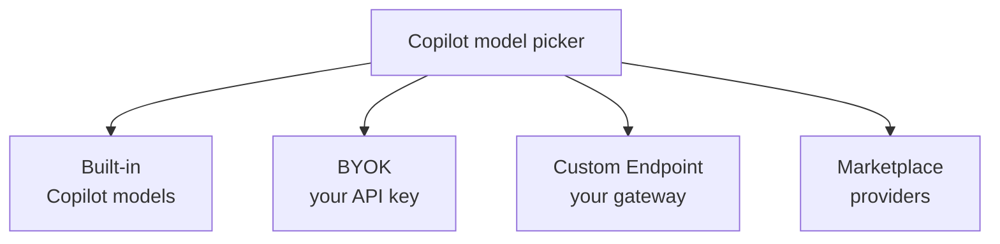
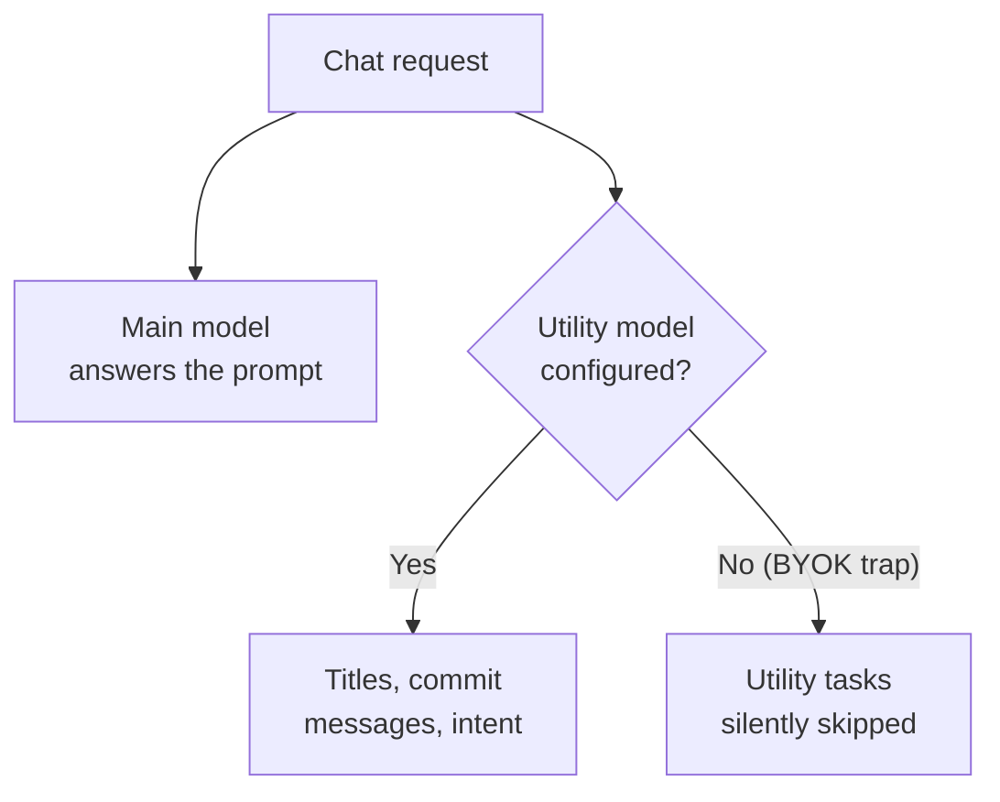

# Selecting Models


GitHub Copilot lets you drive chat and agent sessions with more than one model, and the right choice is a capability decision rather than a brand-name decision. What matters for a given task is the model's context size, its reasoning depth, and its cost per request, not which vendor shipped it. VS Code exposes these tradeoffs directly in the model picker, so you can match a fast, cheap model to routine edits and a deeper model to architectural work. This topic covers how models reach Copilot, how you tune them, and the settings that keep background tasks like commit messages and titles working.

> Note: The paths below describe VS Code. In Visual Studio and JetBrains IDEs the equivalent model controls live under the Copilot settings for that IDE.

## How models reach Copilot

A model can arrive through several provider types, and each type has a different tradeoff between convenience, privacy, and setup effort. Built-in models need only a signed-in Copilot license. Bring your own key (BYOK) and Custom Endpoint providers let you point Copilot at models you host or pay for directly. Additional providers install from the Marketplace like any other extension.

| Provider type | How it connects | When to reach for it |
|---|---|---|
| Built-in Copilot models | Signed-in Copilot license | Default path, no extra configuration |
| BYOK (bring your own key) | Your API key, no GitHub sign-in required | Air-gapped or offline work, direct billing |
| Custom Endpoint | Your endpoint URL and request shape | Self-hosted or proxied models behind your own gateway |
| Marketplace providers | Installed as an extension | Adding a provider Copilot does not ship by default |



## Working offline with BYOK

BYOK lets you configure a model with your own API key and use Copilot chat and agent sessions without signing in to GitHub. This unlocks air-gapped and fully offline workflows where a self-hosted model answers every request and no traffic leaves your network. You supply the key and endpoint, Copilot routes chat and agent traffic to it, and the built-in credit allowance is never touched.

The tradeoff is that only the interactive surfaces work without sign-in. Inline suggestions and Next Edit Suggestions still require a signed-in Copilot license, so a BYOK-only setup gives you chat and agents but not ghost-text completions.

> Note: If you need both inline completions and an offline chat model, sign in for the completions and configure BYOK for the chat and agent model separately.

## Custom Endpoint provider

The Custom Endpoint provider replaces the legacy OpenAI-compatible provider and understands three request shapes, so you can front most self-hosted or proxied models without a shim. Pick the shape your endpoint speaks and Copilot formats requests accordingly.

| Request shape | Typical backend |
|---|---|
| `chat-completions` | OpenAI-style chat APIs and compatible gateways |
| `responses` | OpenAI Responses API endpoints |
| `messages` | Anthropic-style messages endpoints |

## Tuning a model with modelOptions

Per-model `modelOptions` let you set sampling parameters like `temperature` and `top_p` for an individual model rather than globally. Lower the temperature for deterministic refactors and code generation, raise it when you want the model to explore alternatives. Because the setting is per model, a deterministic utility model and an exploratory main model can coexist in the same workspace.

## Utility models and the BYOK trap

Copilot runs small background tasks that are separate from your main prompt: generating chat titles, writing commit messages, and detecting intent. These tasks are driven by dedicated utility model settings so they do not consume your strongest, most expensive model.

| Setting | What it drives |
|---|---|
| `chat.utilityModel` | The main utility model for titles, commit messages, and intent detection |
| `chat.utilitySmallModel` | A smaller, cheaper model for the lightest utility tasks |
| `chat.byokUtilityModelDefault` | The default utility model used when your main model is BYOK |

The trap appears when you switch your main model to BYOK without configuring a utility model. Built-in utility defaults do not apply to a BYOK main model, so titles, commit messages, and intent detection silently stop running with no error. Set `chat.byokUtilityModelDefault` (or an explicit `chat.utilityModel`) whenever you go BYOK so the background tasks keep working.



## Context size and reasoning effort

Supported Anthropic and OpenAI models offer 1M-token context windows, enough to hold a large codebase, long conversation history, and detailed instructions at once. A wider window costs more per request, so it is a budget decision as much as a capability one. VS Code surfaces both dials in a unified picker: you choose the context size and the reasoning effort (thinking effort) for a model in the same place. Raise reasoning effort for hard debugging or design work, and keep it low for routine edits to save cost and latency.

## Switching providers and cost

The model picker lists Copilot and Anthropic models in one list, and you can switch providers between turns inside the same conversation. It also shows each model's cost beside its name, so choosing a model is a budget decision at the point of choice. Hovering the footer of a chat response shows per-model input, cached input, and output tokens. Credit accounting and per-session cost are covered in [Governance: Cost](../../08-governance/02-cost-byok/).

## Marketplace providers and Ollama

New model providers install from the Marketplace like any other extension. The built-in Ollama provider is deprecated in favor of the official Ollama extension.

## Copilot Fusion: let Copilot choose the models

Picking a model by hand works when you know the task, but many requests are mixed: a quick rename next to a risky refactor. Copilot Fusion removes that decision. Select **Copilot Fusion** in the model picker and Copilot routes each request and orchestrates models for you. Fusion has been generally available since VS Code 1.144; it combines the multi-model orchestration of Project HydraFusion, a Research Preview in VS Code 1.140, with the task-aware selection of Copilot auto model selection.

For every request Fusion chooses three things: the models, the reasoning effort, and the execution pattern. A simple task is completed by one model. For a harder task, one model drafts the answer and other models review or critique it before you see the result. You never configure this pattern; you only choose how much effort you want to spend.

The effort level is your one control. It decides how much orchestration a request gets, so it also decides how much the request costs.

| Effort level | Use it for |
|---|---|
| Standard | Everyday coding |
| High | More demanding tasks |
| Max | The most complex tasks |

Fusion High and Max are offered on Copilot Pro+, Max, Business and Enterprise plans. Standard is the right default for routine edits, and High or Max earn their cost on work where a second opinion from another model catches mistakes, such as a cross-service refactor or a subtle concurrency bug.

Fusion is transparent after the fact. Hover over the effort level below a response to see which models were used, so you can learn which of your tasks really needed more than one. That feedback loop is the practical value: after a week you know which kinds of work deserve High or Max, and you stop paying for orchestration on the tasks that never needed it. Compare this with choosing a model by hand, where you only learn that a cheaper model would have sufficed after the bill arrives.

Billing follows the models: every model Fusion uses is billed at its standard rate, so a drafted-and-reviewed answer costs more than a single-model answer. Through November 30, 2026, paid Copilot plans get a 30% discount on Fusion.

> Note: Fusion is a VS Code model picker entry. Visual Studio and JetBrains IDEs keep their own model lists, so check the picker there for an equivalent.

## Comparing models and harnesses side by side

Sometimes you want to decide yourself by running one prompt on several models. Since VS Code 1.143 (Preview) the Agents window can do this, and since 1.144 it is on by default for eligible new sessions through the setting `sessions.chat.compareAgents.enabled`. Select **Compare Models** in the model picker, or press Ctrl+Alt+M (macOS ⌥⌘M) from an eligible chat input.

You pick two or more models, and you can mix Copilot, Claude and Codex harnesses and set the reasoning level per attempt. One prompt starts every attempt, and each attempt runs in its own session with its own worktree . An optional **Judge** model scores the attempts with time and token usage, a rationale, validation evidence and links. **Synthesize** builds on the recommended attempt with ideas from the others, on request.

Since 1.144 comparison also works from a folderless chat (without judge or synthesizer) and from a local or empty repository. It is not supported in Dev Containers.

## Demo

1. Open the Command Palette and run `Preferences: Open User Settings (JSON)`.
2. Add a Custom Endpoint or BYOK model by supplying your endpoint URL, the matching request shape (`chat-completions`, `responses`, or `messages`), and your API key.
3. Open the model picker in Copilot Chat and confirm your new model appears with its cost shown beside it.
4. Select the new model, start a chat, and notice that with BYOK you did not need to sign in to GitHub for the chat to work.
5. Set `chat.byokUtilityModelDefault` to a small model, then make a small edit and generate a commit message; confirm the commit message and chat title are produced.
6. Temporarily remove the utility model setting, repeat the commit-message step, and observe that the title and commit message no longer generate. This is the BYOK utility trap.
7. Restore the utility model setting and confirm background tasks resume.
8. Send a chat request, then hover the footer of the response to read the per-model input, cached input, and output token counts.
9. Select **Copilot Fusion** in the model picker, choose the **High** effort level, and send the prompt below. Hover over the effort level below the response to see which models were used.

   ```text
   Review src/ for functions with more than three nested conditions and propose a refactor for the worst one.
   ```

   Expected result: the response arrives and the hover lists the models Fusion used; a harder prompt shows more than one model, a simple one shows one.
10. In the Agents window, press Ctrl+Alt+M (macOS ⌥⌘M) from the chat input, pick two models, and send the prompt below. Compare the attempts, each in its own session and worktree.

    ```text
    Add input validation to the signup form and explain which checks you added.
    ```

    Expected result: two attempts run side by side, one per model; with a Judge model selected, a scorecard shows time and token usage for each attempt.

## Links & Resources

- [Language models in VS Code](https://code.visualstudio.com/docs/copilot/language-models) - configuring BYOK, custom endpoints, and per-model options
- [Copilot Fusion in VS Code](https://aka.ms/vscode-copilot-fusion) - how Fusion routes requests, its effort levels, and billing
- [Compare models in VS Code](https://code.visualstudio.com/docs/agents/run/compare-models) - running one prompt across models and harnesses, with Judge and Synthesize
- [Changing the AI model for Copilot Chat](https://docs.github.com/en/copilot/using-github-copilot/ai-models/changing-the-ai-model-for-copilot-chat) - selecting and comparing models across supported IDEs

[← Previous: Getting Started & Configuring Copilot](../01-intro/readme.md) | [Back to Fundamentals](../readme.md) | [Next: Shaping the Context Window →](../03-context-window/readme.md)
