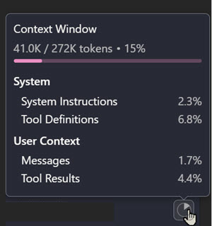
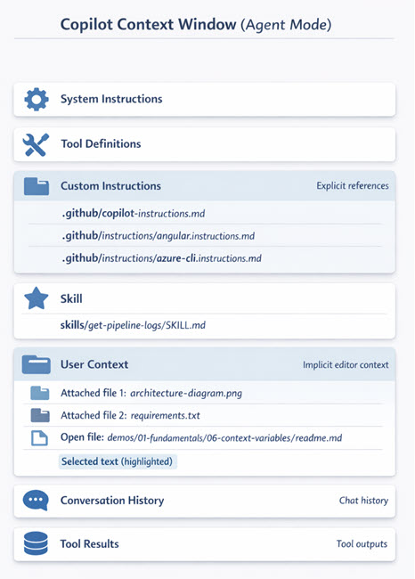
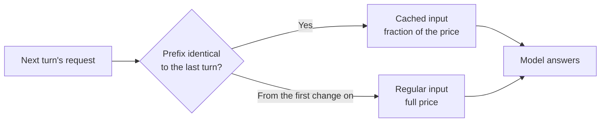

# Context Window Optimization & Prompt Caching

Context engineering is the practice of deliberately designing what information GitHub Copilot receives. When you understand what fills the context window and compose it on purpose, first drafts fit your style and stack, and you spend fewer cycles correcting guesses about your conventions.

Context Window indicator showing token usage:

## What Fills Your Context Window

Each model has a fixed context window, and several layers compete for it. System instructions and tool definitions (provided by GitHub Copilot) form the base. Custom instructions, skills, and conversation history consume additional tokens. User context (attached files, open files, selections, references) uses the remaining budget for the problem at hand.

GitHub Copilot Agent Mode Context Window showing all component layers:

## Prompt Caching and Cached Tokens

Most models behind GitHub Copilot cache the unchanged prefix of a request. When a new turn starts with exactly the same tokens as the turn before (system instructions, tool definitions, custom instructions, earlier conversation turns), the provider reads that prefix from its cache and skips processing it again. The cached part returns faster and is billed as cached input, and only the new tail of the request is processed at the full input price. Caching depends on the provider and the model, so the same prompt can show high reuse on one model and none on another.

This turns context engineering from a one-time composition into a decision about ordering. Keep the cacheable part stable and up front, and let the volatile part (your latest question, the current selection) come last.

### What Cached Tokens Cost

GitHub Copilot bills usage as AI credits, priced from the input, output, and cached tokens of every turn at the model's published rate. Cached input costs a tenth to a twentieth of regular input. Writing a prefix into the cache costs a little more than regular input for Anthropic models and the GPT-5.6 and GPT-6 families, so a prefix pays off once it is read again on the following turns.

| Claude Sonnet 5.5, per 1M tokens | Price |
|---|---|
| Input | $2.00 |
| Cache write | $2.50 |
| Cached input | $0.10 |
| Output | $10.00 |

A long agent session resends the same instructions, tool definitions, and history on every turn, and that repeated prefix is what the cached rate applies to. Per-session credit accounting is covered in the [Governance module](../../08-governance/02-cost-byok/).

> Note: Legacy annual Copilot Pro and Pro+ plans still bill per premium request. On those plans caching shortens the response time, and the bill counts requests.

### What Breaks the Cache

The cache matches from the first token onward, so the first difference between two consecutive requests ends the reuse for everything after it. These changes rewrite the beginning of the request:

- Switching the model, the reasoning effort, or the context size in the middle of a session
- Enabling an MCP server or changing the tool selection between turns
- Editing `copilot-instructions.md`, an instructions file, or a custom agent definition while you work
- Adding or replacing attachments early in the conversation
- Compacting the history with `/compact` or starting a new session, which replaces the earlier turns

Choose the model, reasoning effort, context size, and tools before the first request, and keep shared instructions stable while a session runs. Compact or start over on purpose, at the point where the old history stops helping the task. Answer quality still comes first: keep every instruction and tool the task needs, even when it costs cache reuse.

### Seeing Cache Reuse

Each surface reports whether the cache worked for a turn:

| Where | What it shows |
|---|---|
| Response footer hover in VS Code | Input, cached input, and output tokens for that response |
| Cache Explorer in the VS Code Agent Debug Logs | Cache hit percentage per turn, reused input tokens, and the first divergence between two consecutive requests |
| Turn summary in Copilot CLI | The `Tokens` line with the cached share of the input, for example `↑ 73.5k (1.0k cached) • ↓ 2` |

To open the Cache Explorer, select the ellipsis (**...**) menu in the Chat view, select **Show Agent Debug Logs**, select the session description in the breadcrumb, and then select **Cache Explorer**. Pick a turn with low reuse, find the first divergence in the prompt signature, and expand that component to see what changed. When the change was necessary (an MCP server the task needs), keep it and accept the lower reuse; when it was avoidable, set it up before the first request of the next session.

## Strategies for Effective Context Engineering

Attach project instructions so Copilot knows your naming conventions, preferred libraries, and architectural patterns. Reference only the source files the task needs, so the tokens go to what helps with this specific task.

> ProTip: Summarize your context in a feature-xxx.md file, start a new conversation, and attach that file to continue with a fresh context window that holds only the relevant information.

## Links & Resources

- [Context Engineering Guide](https://code.visualstudio.com/docs/agents/guides/context-engineering-guide) - composing instructions, plans, and focused context for agent sessions
- [Diagnose prompt caching with the Cache Explorer](https://code.visualstudio.com/docs/agents/agent-troubleshooting/cache-explorer) - finding the first divergence behind a cache miss
- [Models and pricing](https://docs.github.com/en/copilot/reference/copilot-billing/models-and-pricing) - input, cached input, and cache write rates per model

[← Previous: Selecting Models](../02-models/readme.md) | [Back to Fundamentals](../readme.md) | [Next: AI-Assisted Coding Essentials →](../04-ai-assisted-coding/readme.md)
