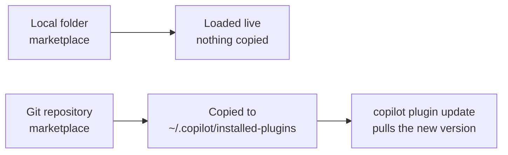
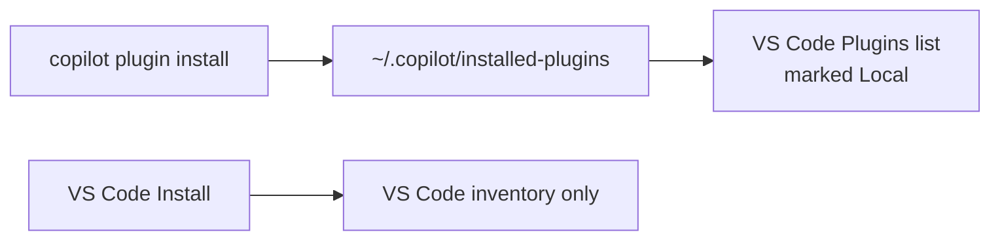

# Publishing Plugins through Your Own Marketplace

A plugin you point at with `--plugin-dir` or `chat.pluginLocations` works on your machine and nowhere else. Your team needs to find it, install it with one command, and receive the next version without copying folders around. A plugin marketplace does that: it is a catalog file in a folder or a Git repository that lists your plugins, and every Copilot surface that adds it can browse, install and update them.

This topic wraps the [demo-quality plugin](../01-authoring/demo-quality-plugin/) from [Authoring Agent Plugins](../01-authoring/readme.md) in a marketplace and installs it in the Copilot CLI and in VS Code. The [Hands-On Lab](#hands-on-lab) then publishes a team marketplace with two plugins from a GitHub repository.

## The catalog: marketplace.json

A marketplace is defined by one file, `marketplace.json`. It names the marketplace, names its owner, and lists the plugins with the folder each one lives in. The CLI needs nothing else: there is no server, no registry account and no build step.

This class ships its own catalog at [`06-plugins/.github/plugin/marketplace.json`](../.github/plugin/marketplace.json):

```json
{
  "name": "class-plugins",
  "owner": {
    "name": "Alexander Kastil"
  },
  "metadata": {
    "description": "Plugins built in the Agentic Software Engineering with GitHub Copilot class",
    "version": "1.0.0"
  },
  "plugins": [
    {
      "name": "demo-quality",
      "description": "Quality gate for the demo and lab guides in this masterclass: a readme checker skill, a topic-index MCP server, a review agent, and a brand-voice hook.",
      "version": "1.0.0",
      "source": "./01-authoring/demo-quality-plugin"
    }
  ]
}
```

| Field | Required | What it does |
| ----- | -------- | ------------ |
| `name` | Yes | Kebab-case marketplace name, at most 64 characters. It becomes the second half of every plugin identifier. |
| `owner` | Yes | `{ name, email? }` of whoever maintains the catalog. |
| `plugins` | Yes | One entry per plugin. Each entry needs `name` and `source`; `description` and `version` are what people see when they browse. |
| `metadata` | No | `{ description?, version?, pluginRoot? }` for the catalog itself. |

The marketplace name is the `name` field in the catalog; the folder or repository name plays no part. Plugins are addressed as `PLUGIN-NAME@MARKETPLACE-NAME`, so `demo-quality@class-plugins` is the identifier you install, update and remove. Renaming the marketplace renames every identifier, which breaks every setting and script that refers to them, so pick a stable name once.

`source` is the path to the plugin's directory relative to the root of the marketplace, and the plugin has to live inside that root. The class catalog therefore sits in `06-plugins/`, the folder that holds both subtopics, so `./01-authoring/demo-quality-plugin` resolves inside it. A catalog placed in `02-marketplaces/` with `"source": "../01-authoring/demo-quality-plugin"` registers fine and then fails at install time with `Plugin path escapes marketplace directory`.

## Where Copilot looks for the catalog

The CLI checks four locations in the marketplace root, in this order, and uses the first one it finds:

| Order | Location | Notes |
| ----- | -------- | ----- |
| 1 | `marketplace.json` | The catalog file at the root of the folder or repository |
| 2 | `.plugin/marketplace.json` | A hidden `.plugin/` folder at the root |
| 3 | `.github/plugin/marketplace.json` | The location GitHub's guide uses for a marketplace hosted on GitHub |
| 4 | `.claude-plugin/marketplace.json` | The location Claude Code reads, so one repository can serve both agents |

`.github/plugin/` is where GitHub's own guidance puts the catalog, and it is where `github/awesome-copilot`, the marketplace every Copilot surface includes by default, keeps it. The fourth location is the reason one repository can serve two agents.

## A local folder or a Git repository

`copilot plugin marketplace add` accepts a local path, a GitHub `owner/repo` (optionally `owner/repo#ref`), or a Git URL. The two kinds behave differently after the install, and the difference decides which one you use.

A local folder is a development loop. The CLI records the folder as a `directory` source and loads every plugin live from its real directory: it copies nothing, an edit takes effect in the next session, and `copilot plugin update` reports that there is nothing to update. That is what you want while the plugin is still changing, and it is useless for anyone who does not have your disk.

A Git repository is distribution. The CLI clones the catalog, copies each installed plugin into `~/.copilot/installed-plugins/<marketplace>/<plugin>`, and `copilot plugin update` fetches the repository again and replaces the copy when the version changed. A team publishes by pushing a commit; members pick it up with one command.



> Note: A relative path with a single separator, such as `./plugins`, is read as a GitHub `owner/repo` and the CLI tries to clone `https://github.com/./plugins.git`. Pass a path with more segments, an absolute path, or `"$PWD"` from inside the folder.

## One repository for Copilot and Claude Code

A plugin repository does not have to choose an agent. Put the Copilot catalog in `.github/plugin/marketplace.json` and the Claude Code catalog in `.claude-plugin/marketplace.json`, both pointing at the same plugin folders, and each agent reads its own file. The class marketplace does exactly that: [`06-plugins/.claude-plugin/marketplace.json`](../.claude-plugin/marketplace.json) lists the same `demo-quality` entry for Claude Code.

Microsoft uses the same layout at scale. Azure API Center can expose its plugin inventory as a marketplace endpoint, a Git URL of the form `https://<service>.data.<region>.azure-apicenter.ms/workspaces/default/plugins/marketplace.git`, and a clone of it holds `.claude-plugin/`, `.github/` and a `plugins/` folder side by side. Copilot CLI and Claude Code both add it with `/plugin marketplace add <url>` and install with `/plugin install <plugin>@<marketplace>`.

What each agent loads from the shared plugin folder is still decided by the plugin format. Added to Claude Code, `demo-quality` installs with one skill and no agent, hook or MCP server. The agent and the hook live under `com.github.copilot/`, which only Copilot reads, and the `topic-index` server in `mcp.json` did not load in Claude Code either, so the skill is the part that travels.

## Installed plugins and two inventories

`~/.copilot/installed-plugins` is the CLI's install folder, and VS Code reads it too. A plugin you install from a Git marketplace in the CLI shows up in VS Code's **Plugins** list, marked **Local**, without any step in VS Code.

The sharing stops there. The Agent Customizations editor in VS Code and the Copilot CLI keep separate plugin inventories: a plugin installed in VS Code is missing from `copilot plugin list`, and a marketplace added in the CLI is missing from VS Code's sources until you add it there too. Manage a plugin from the surface where you installed it.



VS Code stores the marketplaces you add in the `chat.plugins.marketplaces` user setting. It accepts the same `owner/repo` shorthand, a Git URL, or a `file:///` URI for a folder on disk, and it asks you to trust the source before the first install, because a plugin can run code on your machine.

## Demo: Publish demo-quality through the Class Marketplace

The catalog already ships in [`06-plugins/`](../), so this demo registers it, installs from it and watches what each surface does. Run the commands from the root of your clone of this repository.

### Step 1: Register the folder as a marketplace

```bash
copilot plugin marketplace add ./demos/02-agentic-harness/06-plugins
copilot plugin marketplace browse class-plugins
```

```text
Marketplace "class-plugins" added successfully.
Plugins in "class-plugins":
  • demo-quality - Quality gate for the demo and lab guides in this masterclass: a readme checker skill, a topic-index MCP server, a review agent, and a brand-voice hook.

Install with: copilot plugin install <plugin-name>@class-plugins
```

The name `class-plugins` is the catalog's `name` field, and the folder is still called `06-plugins`. `copilot plugin marketplace list` now shows it under **Registered marketplaces** as `Local`, below the included `awesome-copilot`.

### Step 2: Install the plugin and see what loaded

```bash
copilot plugin install demo-quality@class-plugins
copilot plugin list
copilot mcp list
```

```text
Plugin "demo-quality" installed successfully. Installed 1 skill.
Enabled "demo-quality@class-plugins". It is loaded live from ...\demos\02-agentic-harness\06-plugins\01-authoring\demo-quality-plugin, so edits take effect on the next session — nothing was copied.
Live Plugins (loaded from a local marketplace directory, never copied):
  • demo-quality@class-plugins (v1.0.0) (enabled)
      from ...\demos\02-agentic-harness\06-plugins
Plugin servers:
  topic-index (local)
```

`copilot skill list` now lists `demo-readme-check` under **Plugin skills**. Compare the last two lines with Step 6 of the authoring demo: with `--plugin-dir` the CLI did not load `topic-index`, and after a marketplace install it appears under **Plugin servers**.

### Step 3: Bump the version and run the update

Open `demos/02-agentic-harness/06-plugins/01-authoring/demo-quality-plugin/plugin.json` and change `"version": "1.0.0"` to `"version": "1.1.0"`. Then:

```bash
copilot plugin list
copilot plugin update demo-quality@class-plugins
```

```text
Live Plugins (loaded from a local marketplace directory, never copied):
  • demo-quality@class-plugins (v1.1.0) (enabled)
      from ...\demos\02-agentic-harness\06-plugins
Plugin "demo-quality@class-plugins" is always loaded live from ...\demos\02-agentic-harness\06-plugins; there is nothing to update.
```

The list already shows `v1.1.0` before the update runs, and the update has nothing to do. That is the local-folder behavior: your edit is the release. The update command earns its place once the marketplace is a Git repository, which is what the lab publishes. Set the version back to `1.0.0` when you are done.

### Step 4: Register the same folder in VS Code

1. Run **Chat: Open Customizations** from the Command Palette and select **Browse**.
2. Open the **All Sources** menu next to the search box and select **Configure Marketplaces**.
3. Select **Add Marketplace...**. The input asks for an `owner/repo, Git URL, or local repository URI`.
4. Enter the folder as a `file:///` URI and press Enter:

```text
file:///<path-to-your-clone>/demos/02-agentic-harness/06-plugins
```

Expected: **Browse** gains a section named after the folder path with `demo-quality` and an **Install** button. Select **Install**, then **Trust** in the **Trust Plugins from ...** dialog. **Plugins** now lists `demo-quality` under **User** with `1 agent • 1 skill`, and **MCP Servers** and **Hooks** each count one entry. VS Code loads the agent and the hook that Claude Code ignored, because it reads `com.github.copilot/`.

> Note: **Chat: Manage Plugin Marketplaces** in the Command Palette opens the same list without going through **Browse**.

### Step 5: Prove the inventories are separate

Run `copilot plugin list` again. It still shows only the live `demo-quality@class-plugins` entry from Step 2: the install you just made in VS Code lives in VS Code's own inventory, so each surface has to be cleaned up on its own.

### Cleanup

```bash
copilot plugin uninstall demo-quality@class-plugins
copilot plugin marketplace remove class-plugins
```

For a live plugin the uninstall answers `disabled. It is still on disk at ... nothing was removed`: the CLI disables the plugin and leaves your folder where it is. In VS Code, select **Uninstall** on `demo-quality` in **Browse**, then remove the `file:///` entry from `chat.plugins.marketplaces` with **Preferences: Open User Settings (JSON)**.

## Hands-On Lab

[Lab 04: Publish a Team Plugin Marketplace](../../../../labs/04-plugin-marketplace/readme.md) builds a marketplace repository with two plugins, publishes it on GitHub, installs it in the Copilot CLI, VS Code and the GitHub Copilot app, and ships a second version through `copilot plugin update`.

## Links & Resources

- [GitHub Copilot CLI plugin reference](https://docs.github.com/en/copilot/reference/copilot-cli-reference/cli-plugin-reference) - the `copilot plugin` commands, the `marketplace.json` fields, the four catalog locations and `~/.copilot/installed-plugins`
- [Creating and sharing a plugin marketplace on GitHub](https://docs.github.com/en/copilot/how-tos/copilot-on-github/customize-copilot/create-and-share-plugin-marketplaces) - the repository layout, the starter template and how to share a private marketplace
- [Enable discovery of API center plugins from a plugin marketplace](https://learn.microsoft.com/azure/api-center/enable-api-center-plugin-marketplace) - one Git marketplace endpoint serving Copilot CLI and Claude Code side by side
- [Azure Copilot Resiliency Agent](https://learn.microsoft.com/azure/copilot/resiliency-agent) - installing a published agent plugin in VS Code and the CLI, Configure Marketplaces, and the separate plugin inventories

[← Previous: Authoring Agent Plugins](../01-authoring/readme.md) | [Back to Agent Plugins](../readme.md) | [Next: Giving Copilot Memory →](../../07-memory/readme.md)
