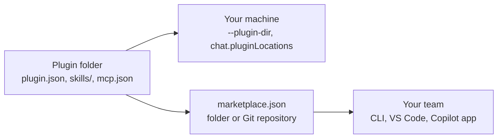

# Agent Plugins

An agent plugin bundles skills, MCP servers, custom agents and hooks into one package that installs with one command. Under Agent Plugins 1.0 the format is an open standard, so the same plugin folder serves VS Code, the Copilot CLI, the GitHub Copilot app and other agents that read the portable parts. This topic covers both ends of a plugin's life: writing one, then getting it to the people who use it.

Work through them in order. Authoring builds and verifies the class's own `demo-quality` plugin from a folder you point at. Publishing then registers this directory as a marketplace: it holds [`.github/plugin/marketplace.json`](.github/plugin/marketplace.json) for Copilot and [`.claude-plugin/marketplace.json`](.claude-plugin/marketplace.json) for Claude Code, and both list that same plugin.

| Topic | Description |
|-------|-------------|
| [Authoring Agent Plugins](./01-authoring/) | The `plugin.json` manifest and its schema, the portable `skills/` and `mcp.json` core versus the `com.github.copilot/` directory, and loading a plugin you are still editing with `--plugin-dir` and `chat.pluginLocations`, demonstrated on the `demo-quality` plugin with a skill, an MCP server, an agent and a hook. |
| [Publishing Plugins through Your Own Marketplace](./02-marketplaces/) | The `marketplace.json` catalog and the four places Copilot looks for it, a local folder versus a Git repository as the source, one repository serving Copilot and Claude Code, `~/.copilot/installed-plugins`, and the separate plugin inventories of VS Code and the CLI. |

## Links & Resources

- [Plugins for GitHub Copilot](https://docs.github.com/en/copilot/concepts/agents/copilot-cli/about-cli-plugins) - which Copilot surfaces install plugins, the Agent Plugins 1.0 layout, and how marketplaces make plugins available
- [GitHub Copilot CLI plugin reference](https://docs.github.com/en/copilot/reference/copilot-cli-reference/cli-plugin-reference) - the `plugin.json` and `marketplace.json` fields and every `copilot plugin` command

[← Previous: Custom Agents](../05-agents/readme.md) | [Back to Agentic Harness](../readme.md) | [Next: Giving Copilot Memory →](../07-memory/readme.md)
