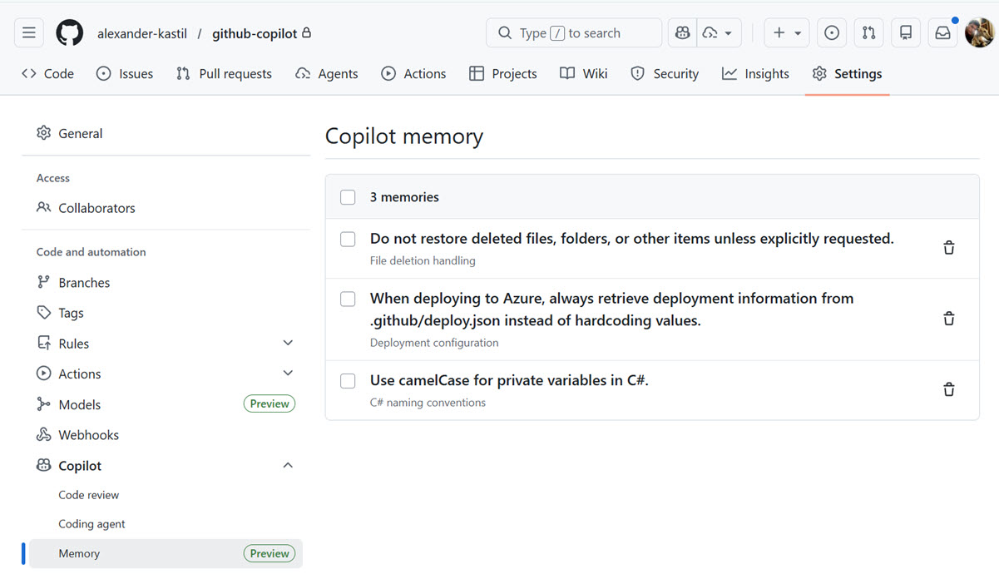

# Giving Copilot Memory


## What is Copilot Memory?

Copilot Memory enables Copilot to build a persistent understanding by storing tightly scoped information that it deduces through interactions. Memories are validated against current code citations, automatically deleted after 28 days if unused, and scoped either to the repository (repository facts) or to you (user preferences). This persistent knowledge reduces the burden of repeatedly explaining coding conventions and maintaining custom instruction files, allowing Copilot to adapt to your repository's patterns and deliver increasingly better results over time.

## Enable Copilot Memory

Copilot Memory is enabled by default in Copilot harness sessions and respects your Copilot Memory settings on GitHub and organization policies. The VS Code setting that controls it:

```json
{
  "github.copilot.chat.copilotMemory.enabled": true
}
```

Copilot Memory is used by **Copilot harness** sessions in VS Code, **Copilot coding agent**, **Copilot code review**, and **Copilot CLI**.

## Copilot Memory in the Copilot Harness

Since VS Code 1.144, sessions that run in the Copilot harness use Copilot Memory. It is the same cloud memory service that Copilot CLI, Copilot cloud agent and Copilot code review use. A fact learned in one of these places is available in the others, because the memory belongs to the service and not to the surface. A convention the cloud agent picked up in a pull request can shape the next session in your editor.

The agent works with memory at two moments. When a session starts, it recalls relevant repository facts and your preferences. While you work, it stores new learnings. You do not write these entries by hand, which is the difference to instruction files: memory grows from what happens in the sessions.

Memories have one of two scopes, and the scope decides who benefits from a fact.

| Scope | What it holds | Who sees it |
| ----- | ------------- | ----------- |
| Repository facts | Conventions and decisions of the codebase, such as where deployment metadata lives | Everyone who has access to the repository |
| User preferences | Your personal habits, such as the style of commit messages | You, across your repositories |

Say the scope in the request when it is not obvious. A preference that should follow you into every project needs to be named as such:

```text
Across all my repositories, remember that I prefer concise commit message subjects.
```

Without a stated scope the agent has to guess, and a repository fact is shared with everyone who has access to the repository. Keep personal taste out of the repository scope, and keep team conventions out of your preferences.

Memory is enabled by default. It respects your Copilot Memory settings on GitHub and the policies of your organization, so a team can switch it off for everyone. You stay in control of what is stored: review and delete memories on GitHub at https://github.com/settings/copilot/memory.

The use cases below show what such memories look like once they are stored: a deployment source of truth, a respected deletion and a naming convention. The first and the third are repository facts that every teammate benefits from. The second is closer to a personal preference about how you want Copilot to treat your workspace.

## Use Cases & Examples

Memory ist stored in the settings of your GitHub repository:



### 1. Deployment Configuration Management

When Copilot discovers your repository maintains a [deploy.json](/.github/deploy.json) file as the single source of truth for Azure deployment metadata (service connections, container registries, environments), it stores this as a memory. Later, when scripting deployments or creating pipelines, Copilot automatically retrieves configuration from this file instead of hardcoding values, ensuring consistency across all deployment operations.

```text
Memory: "Deployment configuration always sourced from .github/deploy.json"
Citations: Lines 1-10 in .github/deploy.json (defines Azure Service Connection, ACR, ACA environment)
Use: Deployment scripts and pipeline generation automatically read values from deploy.json
```

### 2. Respecting Intentional Deletions

Copilot learns your preferences about file and folder management. When you intentionally delete files, folders, or other items from your workspace, Copilot remembers this preference and respects those deletions rather than automatically restoring or recovering them in future operations. This ensures deleted items remain gone unless you explicitly ask for restoration.

```text
Memory: "Do not restore deleted files, folders, or items unless explicitly requested"
Behavior: User deletes unnecessary files or outdated configurations
Use: Copilot avoids suggesting recovery or restoration of intentionally deleted items
```

### 3. C# Private Variable Naming Conventions

Copilot learns your C# coding style preferences. When it observes or is told that your codebase uses camelCase for private variables (e.g., `_userName`, `_connectionString`), Copilot stores this as a memory. Later, when generating new C# classes, refactoring existing code, or reviewing pull requests, Copilot automatically applies this naming convention to all private fields and variables without requiring repeated instructions.

```text
Memory: "Use camelCase for private variables in C#"
Pattern: Private fields like _userId, _configSettings, _apiKey
Use: Code generation and refactoring automatically apply camelCase naming to new private members
```

## Links & Resources

- [GitHub Copilot Memory Concepts](https://docs.github.com/en/copilot/concepts/agents/copilot-memory)
- [Copilot Memory in VS Code](https://code.visualstudio.com/docs/agents/run/memory) - how Copilot harness sessions recall and store memories
- [Enabling and Curating Copilot Memory](https://docs.github.com/en/copilot/how-tos/use-copilot-agents/copilot-memory)

[← Previous: Agent Plugins](../06-plugins/readme.md) | [Back to Agentic Harness](../readme.md) | [Next: GitHub Copilot Hooks →](../08-hooks/readme.md)
