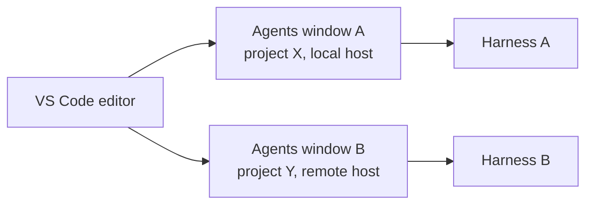

# The Agents Window


The Agents window is a dedicated companion window for running agents across multiple projects at once. It is the primary surface for agent work rather than an experiment beside it. It sits beside your editor rather than inside it, so agent work no longer competes with the file you are reading for screen space. Each window is independent: you can point one at a different model, a different project, or a different execution host while the others keep running.

The window matters because agentic work is no longer a single blocking conversation in the sidebar. A selectable agent harness lets you choose which backend runs a given session, remote execution lets that session run away from your laptop, and per-window setting overrides let each window carry its own configuration. Extensions opt in to appearing in the window through the `extensions.supportAgentsWindow` capability, so tools you already use can surface their agent surfaces here.

## What the Window Gives You

| Capability | What it gives you |
|---|---|
| Companion window | A separate window for agent sessions, kept out of the main editor layout |
| Selectable harness | Choose which agent backend runs a session, per window |
| Remote execution | Run a session on a remote host instead of the local machine |
| Per-window overrides | Model, project, and host settings scoped to one window |
| External sessions | View and continue Copilot or Claude sessions started in other applications |
| `extensions.supportAgentsWindow` | The capability an extension declares to appear in the window |

## How One Window Differs From the Next

The value of separate windows is that each one carries its own context and target. A window overriding the model and host does not change what any other window is doing, which is what makes several projects viable at the same time.



## The Copilot Harness Is the Default

Since VS Code 1.143, a new session starts in the Copilot harness. A harness is the agent backend that runs a session, and you choose it with the harness chip in the composer. The Copilot harness is built on the Copilot SDK, the shared foundation under the Copilot products, so what you learn here carries to the other surfaces.

Selecting **Copilot** in the harness picker marks a Copilot harness session. Such a session runs through the Agent Host, keeps running in the background, and is reachable from both the editor window and the Agents window. Since VS Code 1.142 chat titles show the active harness name, such as Copilot or Codex, so you can tell sessions apart in the list.

| Harness | Where it stands | What to know |
|---|---|---|
| Copilot | Default for new sessions since VS Code 1.143 | Built on the Copilot SDK, runs through the Agent Host, reachable from both windows |
| Local | Being retired | Replaced by the Copilot harness; administrators can keep it for a while |
| Claude | Offered in the picker | Runs on the same Agent Host |
| Codex | Offered in the picker | Runs on the same Agent Host |

The Local harness is being retired, so plan the move to the Copilot harness now. Administrators who need more time can keep it as the default for a while with `vscode.temporaryDefaultToLocalHarness` (since VS Code 1.142) in unified managed settings. VS Code 1.145 publishes a transition guide for moving from Local to Copilot that covers customization compatibility, session continuity, and rollout and verification.

VS Code 1.145 also removed four items from the Local harness: the `#installExtension` tool, the `#runCommand` tool, the `#newWorkspace` tool (previously `#new`), and the `/new` slash command. To create a project now, open an empty folder and describe the project in an agent session. The agent writes the files into that folder, which is the same flow as any other task, so there is no separate scaffolding command to remember.

> Note: The harness chip and the Agents window are VS Code features. Other Copilot surfaces, such as the Copilot CLI and the standalone GitHub Copilot app, share the Copilot SDK foundation but have their own controls.

## Sessions Started Somewhere Else

Agent work does not only start in VS Code. With `chat.agentSessions.showExternal` the Sessions list shows recent Copilot or Claude sessions created in other applications, such as the Copilot CLI or the standalone GitHub Copilot app. Select one and you see its conversation and continue it in VS Code against your own Copilot subscription. The Sessions list submenu filters which external sessions appear, so a busy machine does not flood the list.

## Canvases

Since VS Code 1.142 (Preview), a canvas is an interactive interface beside the chat where you and the agent inspect and update the same artifact. A Kanban canvas is the typical example: you move cards between columns while the agent breaks a feature into tasks and updates their status. Chat describes work in text, while a canvas gives both sides one shared object to point at and change.

Canvases are a Preview in the VS Code desktop app, for local sessions that use the Copilot harness. They work in the editor window and in the Agents window, and canvas extensions are also supported in the GitHub Copilot app. You turn the feature on with the setting `chat.canvases.enabled`.

Every canvas comes from a canvas extension. Enter `/create-canvas` and describe the interface you want: the skill creates a canvas extension in your workspace and opens it. The other route is to install a chat plugin that already includes one, and the awesome-copilot site lists extensions to start from.

| Where you open a canvas | Surface | Since |
|---|---|---|
| **Add Tab (+) > Canvas** | Agents window | Preview launch |
| **New Chat (+) > Canvas** | Editor window | VS Code 1.143 |
| **Add Context (+) > Canvas...** | Any chat | VS Code 1.144 |
| **Canvases** section | Agent Customizations editor | VS Code 1.144 |

VS Code 1.145 adds an Experimental option: select **Add to Sidebar** above a canvas to pin it to the left sidebar. A pinned canvas stays one click away while you move between sessions, which suits a board you consult all day, such as the Kanban example.

Think of a canvas as the answer to a recurring limit of chat: a long transcript is a poor place to track state. A board, a diagram, or a form keeps the current state visible, and either side can change it. The agent edits the artifact through the canvas extension, you edit it by hand, and both of you see the other's change. That is why the same mechanism covers very different interfaces, from task boards to review dashboards, once an extension describes them.

Canvases need the Copilot harness, which is one more reason the default matters. A session on the retiring Local harness cannot open one, so check the harness chip first when a canvas entry point is missing from your menu.

## Demo

1. Open the Agents window: the **Open in Agents** button in the title bar, `Chat: Open Agents window` from the Command Palette, or `code --agents` from a terminal.
2. Select **New**, or press `Ctrl+N`. The composer appears with three chips above the prompt box: the workspace, the harness, and the model.
3. Click the workspace chip and pick a folder from the **Local** tab, then type a prompt to start the session. Confirm it runs in this window, not in the editor's sidebar chat.
4. Start a second session against a different folder and a different model, and watch both run at once without interfering.
5. Press `Ctrl+R` for the Sessions picker to jump between them, holding `Ctrl` and pressing `R` to walk the list, and `Ctrl+Shift+T` to reopen the last chat you closed.
6. Switch the harness chip from Copilot to Claude or Codex on a new session, and confirm the window drives all three the same way.
7. Turn on `chat.agentSessions.showExternal`, start a session in the Copilot CLI, then find it in the Sessions list and continue it here.
8. Open a new session, confirm the harness chip reads **Copilot**, and paste this prompt in an empty folder.

   ```text
   Create a minimal Node.js hello-world HTTP server in this folder with a package.json and a short README.
   ```

   Expected result: the session title shows Copilot, and the project files appear in the folder without a `/new` command.
9. Enable canvases in your user settings.

   ```json
   {
     "chat.canvases.enabled": true
   }
   ```

   Then start a Copilot harness session and enter this prompt.

   ```text
   /create-canvas A Kanban board with To Do, Doing, and Done columns, where I can move cards and you can update their status
   ```

   Expected result: a canvas extension is created in the workspace and the board opens beside the chat. Move a card, then ask the agent to break a small feature into tasks and watch the board update.

## Links & Resources

- [Use the Agents window](https://code.visualstudio.com/docs/agents/run/agents-window) - opening the window, starting sessions, and the composer chips
- [Build with agents in VS Code](https://code.visualstudio.com/docs/agents/overview) - the agent surfaces and how they relate
- [Agent harnesses in VS Code](https://code.visualstudio.com/docs/agents/run/agent-harnesses) - the harness picker, the Copilot default, and the Local retirement
- [Understand agent sessions and handoff](https://code.visualstudio.com/docs/agents/concepts/sessions) - continuing a session started somewhere else

[← Back to Agent Sessions](../readme.md) | [Next: Agent Host Protocol (AHP vs ACP) →](../02-host-protocol/readme.md)
