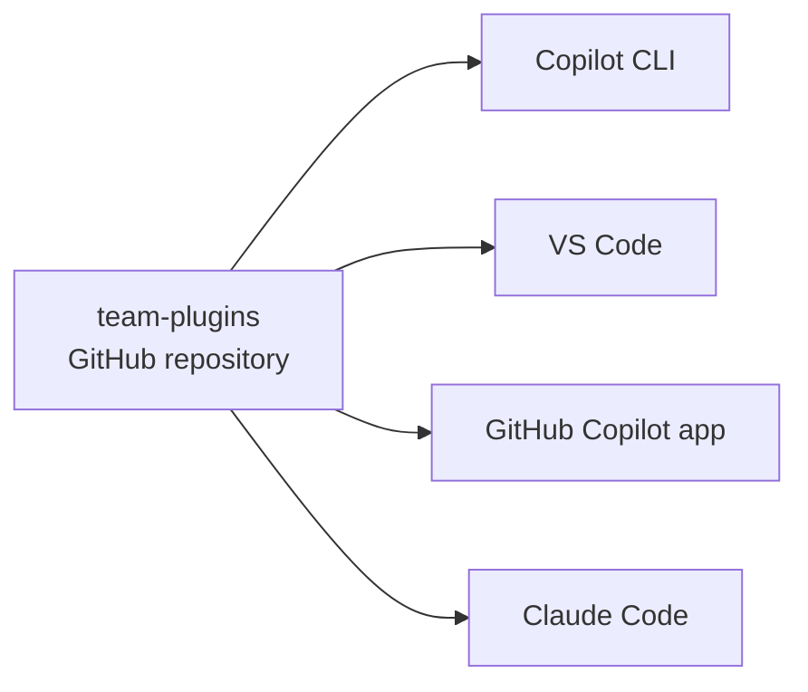

# Publish a Team Plugin Marketplace

Your platform team has written two plugins that every repository should use, and today the only way to get them is to copy a folder from a colleague. Copies drift, nobody knows which version they run, and a fix means another round of copying. In this lab you publish both plugins from one GitHub repository that the Copilot CLI, VS Code, the GitHub Copilot app and Claude Code can all add, then ship a fix to everyone with one commit.

What you practice here: publishing plugins through a versioned marketplace catalog and updating every installed copy from one commit.

Duration: about 50 minutes.

## What you'll build

- `team-plugins`, a private GitHub repository holding two plugins: `commit-conventions` (one skill) and `api-review` (one skill and one Copilot agent)
- A Copilot catalog in `.github/plugin/marketplace.json` and a Claude Code catalog in `.claude-plugin/marketplace.json`, side by side
- Both plugins installed in the Copilot CLI, visible in VS Code, and installable from the GitHub Copilot app
- `api-review` 1.1.0, delivered to the CLI with `copilot plugin update`



## Prerequisites

- The GitHub Copilot CLI, signed in with `/login`, and the GitHub CLI `gh`, signed in with `gh auth login`.
- VS Code with Agent Plugins enabled (`chat.plugins.enabled`). The GitHub Copilot app and Claude Code are optional; their parts are marked.
- [Publishing Plugins through Your Own Marketplace](../../demos/02-agentic-harness/06-plugins/02-marketplaces/readme.md) read, or its demo watched.

Work in a copy of [team-plugins/](team-plugins/) outside this repository; the finished result is beside it in [team-plugins-solution/](team-plugins-solution/).

## Step 1: Copy the starter and read the two plugins (5 minutes)

The starter holds two finished Agent Plugins 1.0 plugins under `plugins/`. Copy it out of the course repository, because it becomes a Git repository of its own in Step 3.

From the root of your clone of this repository, in Bash:

```bash
cp -r labs/04-plugin-marketplace/team-plugins ~/team-plugins
cd ~/team-plugins
```

In PowerShell:

```powershell
Copy-Item -Recurse labs/04-plugin-marketplace/team-plugins ~/team-plugins
cd ~/team-plugins
```

Expected: the folder holds two plugins and no catalog yet.

```text
plugins/
  commit-conventions/
    plugin.json
    skills/conventional-commit/SKILL.md
  api-review/
    plugin.json
    skills/endpoint-review/SKILL.md
    com.github.copilot/agents/api-reviewer.agent.md
```

## Step 2: Write the catalog for Copilot and for Claude Code (8 minutes)

The catalog names the marketplace and points at each plugin folder. Copilot reads `.github/plugin/marketplace.json`; Claude Code reads `.claude-plugin/marketplace.json`; both files list the same folders, so one repository serves both agents.

Create `.github/plugin/marketplace.json`:

```json
{
  "name": "team-plugins",
  "owner": {
    "name": "Contoso Platform Team"
  },
  "metadata": {
    "description": "Plugins the Contoso platform team maintains for every repository",
    "version": "1.0.0"
  },
  "plugins": [
    {
      "name": "commit-conventions",
      "description": "Writes a Conventional Commits message for the staged changes.",
      "version": "1.0.0",
      "source": "./plugins/commit-conventions"
    },
    {
      "name": "api-review",
      "description": "Reviews HTTP endpoints against the team's API guidelines.",
      "version": "1.0.0",
      "source": "./plugins/api-review"
    }
  ]
}
```

Create `.claude-plugin/marketplace.json`:

```json
{
  "name": "team-plugins",
  "owner": {
    "name": "Contoso Platform Team"
  },
  "plugins": [
    {
      "name": "commit-conventions",
      "description": "Writes a Conventional Commits message for the staged changes.",
      "version": "1.0.0",
      "source": "./plugins/commit-conventions"
    },
    {
      "name": "api-review",
      "description": "Reviews HTTP endpoints against the team's API guidelines.",
      "version": "1.0.0",
      "source": "./plugins/api-review"
    }
  ]
}
```

Before you publish, try the catalog from the folder itself. `"$PWD"` works in Bash and PowerShell and avoids the trap where a short relative path is read as a GitHub `owner/repo`.

```bash
copilot plugin marketplace add "$PWD"
copilot plugin marketplace browse team-plugins
copilot plugin marketplace remove team-plugins
```

Expected:

```text
Marketplace "team-plugins" added successfully.
Plugins in "team-plugins":
  • commit-conventions - Writes a Conventional Commits message for the staged changes.
  • api-review - Reviews HTTP endpoints against the team's API guidelines.

Install with: copilot plugin install <plugin-name>@team-plugins
Marketplace "team-plugins" removed successfully.
```

The remove matters: the same name cannot be registered twice, and Step 4 registers it again from GitHub. If you use Claude Code, `claude plugin marketplace add "$PWD"` reads the second file and lists `team-plugins` as a `Folder` source; remove it again with `claude plugin marketplace remove team-plugins`.

## Step 3: Publish the marketplace repository on GitHub (6 minutes)

A Git repository turns the folder into something your team can add by name and update by pushing. Create it private: everyone who adds the marketplace needs read access to the repository, and organization membership alone does not grant it.

```bash
git init -b main
git add .
git commit -m "Team plugin marketplace with two plugins"
gh repo create team-plugins --private --source . --push
```

Expected: `gh` prints the URL of the new repository, and the repository on GitHub shows `.github/plugin/marketplace.json`, `.claude-plugin/marketplace.json` and `plugins/`. From here on, `<you>` stands for your GitHub user or organization.

## Step 4: Install both plugins in the Copilot CLI (8 minutes)

```bash
copilot plugin marketplace add <you>/team-plugins
copilot plugin install commit-conventions@team-plugins
copilot plugin install api-review@team-plugins
copilot plugin list
```

Expected:

```text
Marketplace "team-plugins" added successfully.
Plugin "commit-conventions" installed successfully. Installed 1 skill.
Plugin "api-review" installed successfully. Installed 1 skill.
Installed plugins:
  • commit-conventions@team-plugins (v1.0.0)
  • api-review@team-plugins (v1.0.0)
```

These are copies, which is the difference from the folder in Step 2. List the install folder, then the skills the CLI now loads:

```bash
ls ~/.copilot/installed-plugins/team-plugins
copilot skill list
```

Expected: `api-review` and `commit-conventions` are folders under `installed-plugins/team-plugins`, and `copilot skill list` shows `conventional-commit` and `endpoint-review` under **Plugin skills**.

## Step 5: Use the marketplace in VS Code and the GitHub Copilot app (10 minutes)

VS Code reads the CLI's install folder, so the two plugins are already there. Run **Chat: Open Customizations** and select **Plugins**.

Expected: `api-review` and `commit-conventions` appear under **User**, each marked **Local**, with the path `.copilot\installed-plugins\team-plugins`. `api-review` shows `1 agent • 1 skill`: VS Code loaded the **API Reviewer** agent from `com.github.copilot/agents/`.

A teammate who only uses VS Code adds the marketplace there. Select **Browse**, open the **All Sources** menu, select **Configure Marketplaces**, then **Add Marketplace...**, and enter:

```text
<you>/team-plugins
```

Expected: **All Sources** now lists `<you>/team-plugins`, and **Browse** shows `commit-conventions` and `api-review` from it with an **Install** button, while the two CLI copies above them show **Uninstall**. That is the same plugin in two inventories: VS Code and the CLI each track what they installed, so manage each copy where you installed it.

> Note: If you use the GitHub Copilot app, click **Customize** in the sidebar, select the marketplace settings control next to the marketplace dropdown, add `<you>/team-plugins`, search the **Browse** page for `api-review`, and click **Install**.

## Step 6: Ship a new version to everyone (8 minutes)

The team decides that creating a resource must return `201` with a `Location` header. Add that rule to the skill, bump the version, and push.

In `plugins/api-review/skills/endpoint-review/SKILL.md`, add a sixth rule under the fifth:

```text
6. A `POST` that creates a resource returns `201` with a `Location` header.
```

Change `"version": "1.0.0"` to `"version": "1.1.0"` in `plugins/api-review/plugin.json` and in the `api-review` entry of both catalogs. Then publish and update:

```bash
git commit -am "api-review 1.1.0: check 201 and Location on create"
git push
copilot plugin update api-review@team-plugins
copilot plugin list
```

Expected:

```text
Plugin "api-review@team-plugins" updated successfully (v1.0.0 → v1.1.0). Updated 1 skill.
Installed plugins:
  • commit-conventions@team-plugins (v1.0.0)
  • api-review@team-plugins (v1.1.0)
```

The installed copy under `~/.copilot/installed-plugins/team-plugins/api-review` now carries rule 6. Run `copilot plugin update --all` to update every installed plugin at once.

## Cleanup

```bash
copilot plugin marketplace remove team-plugins --force
```

`--force` uninstalls both plugins with the marketplace. In VS Code, remove `<you>/team-plugins` from `chat.plugins.marketplaces` with **Preferences: Open User Settings (JSON)**, and uninstall anything you installed from **Browse**. Keep the GitHub repository if your team will use it, or delete it on GitHub under **Settings**.

## Troubleshooting

| Symptom | Likely cause | Fix |
| ------- | ------------ | --- |
| `Failed to fetch GitHub marketplace ./team-plugins` | A relative path with one separator is read as a GitHub `owner/repo` | Add the folder as `"$PWD"` from inside it, or with an absolute path |
| `Marketplace "team-plugins" already registered` | The local folder from Step 2 is still registered under the same name | `copilot plugin marketplace remove team-plugins`, then add the GitHub repository |
| `Plugin path escapes marketplace directory` | A `source` points outside the repository, for example `../plugins/api-review` | Keep every plugin folder inside the marketplace repository and use a `./` path |
| `copilot plugin update` says `there is nothing to update` | The marketplace is the local folder, whose plugins load live from disk | Register `<you>/team-plugins` from GitHub so the CLI installs copies it can update |
| A teammate cannot add the marketplace | No read access to the private repository | Grant the teammate or their team read access; organization membership is not enough |

## Summary

You published a team marketplace and shipped a fix through it. You can now:

- Write a `marketplace.json` catalog that serves the Copilot CLI and Claude Code from one repository
- Test a catalog from a local folder before anyone else sees it
- Install marketplace plugins in the CLI and find them in VS Code through `~/.copilot/installed-plugins`
- Add the same marketplace in VS Code and the GitHub Copilot app, and keep the separate inventories apart
- Release a new plugin version with one commit and `copilot plugin update`

## Links & Resources

- [GitHub Copilot CLI plugin reference](https://docs.github.com/en/copilot/reference/copilot-cli-reference/cli-plugin-reference) - every `copilot plugin` command, the `marketplace.json` fields and the install folder
- [Creating and sharing a plugin marketplace on GitHub](https://docs.github.com/en/copilot/how-tos/copilot-on-github/customize-copilot/create-and-share-plugin-marketplaces) - repository layout, the starter template and access for a private marketplace
- [Customizing the GitHub Copilot app](https://docs.github.com/en/copilot/how-tos/github-copilot-app/customize-github-copilot-app) - adding a plugin marketplace and installing plugins in the app
- [Azure Copilot Resiliency Agent](https://learn.microsoft.com/azure/copilot/resiliency-agent) - Configure Marketplaces in VS Code and the separate inventories of VS Code and the CLI
